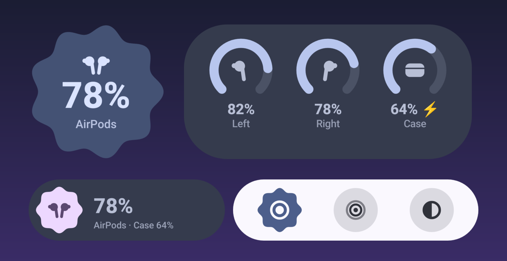
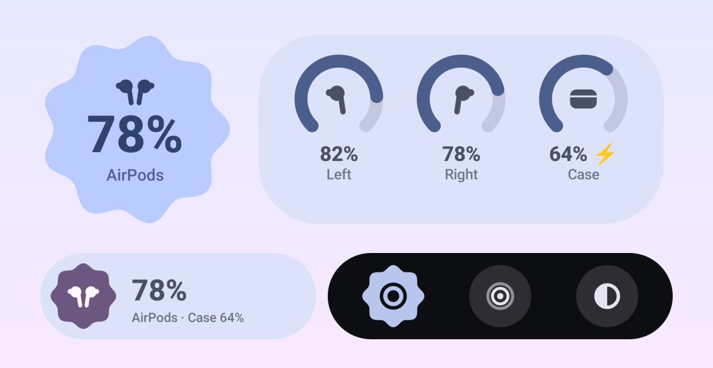
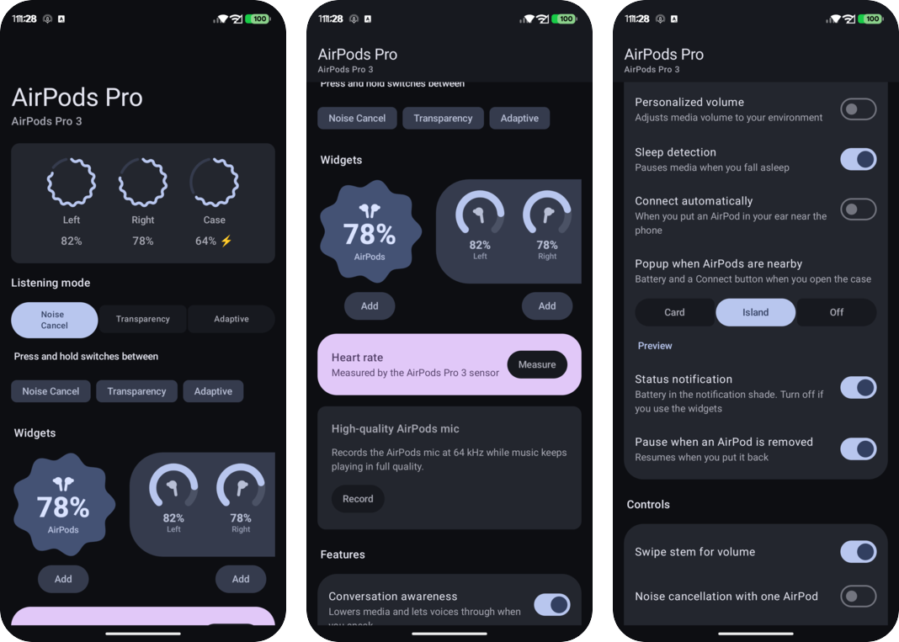
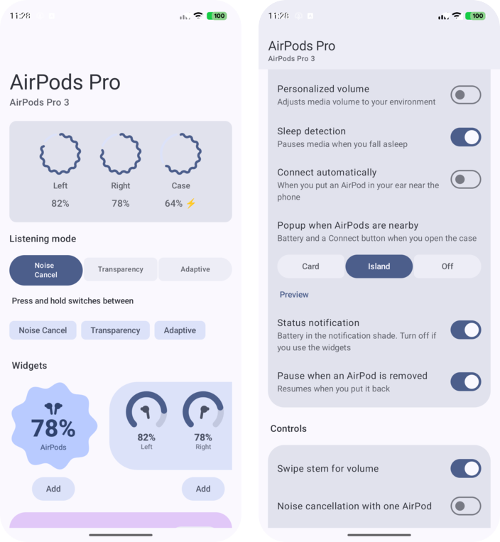
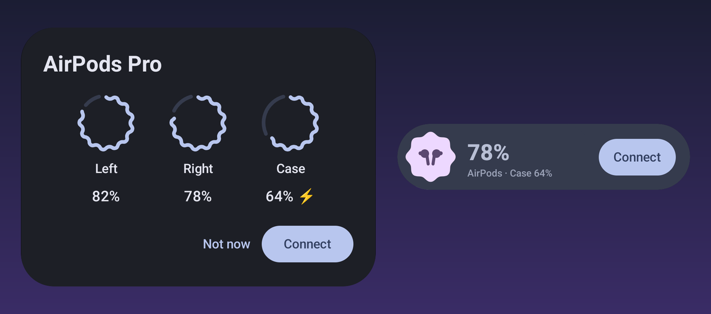

<div align="center">


# MaterialPods

**Your AirPods, finally at home on Android — in Material 3 Expressive.**

Battery, listening modes, ear detection, heart rate and Apple's high-quality AirPods mic,
with wallpaper-coloured widgets and an island popup when you open the case.


</div>

---

## Widgets

Shape-first widgets that float on your wallpaper and follow its colours — light and dark.

<p align="center">
  
  
</p>

| Widget | Size | What it shows |
|---|---|---|
| **Cookie** | 2×2 | The bud that runs out first, huge, on a scalloped cookie |
| **Gauges** | 4×2 | Thick arc gauges for left, right and case |
| **Pill** | 3×1 | Battery at a glance, case on the second line |
| **Listening mode** | 4×1 | Tap to switch — the active mode turns into a sunny shape |

The case only reports its battery while a bud is inside, so MaterialPods remembers the last reading and shows its age (`Case · 2h`).

## The app

<p align="center">
  
</p>

<p align="center">
  
</p>

## Connect popup — card or island

When your AirPods show up nearby (lid opened, taken out) and the phone isn't connected, MaterialPods offers to connect. Pick the style in settings: a **card** that slides up, an **island** that springs open from the front camera like the pill widget — or off.

<p align="center">
  
</p>

## Features

- **Battery** for each bud and the case — live over the control link, or from the case's Bluetooth LE broadcasts when you open the lid, even when not connected.
- **Listening modes**: Noise Cancellation, Transparency, Adaptive (with strength slider), Off — plus which ones press-and-hold cycles through.
- **Ear detection**: pauses when you take an AirPod out, resumes when it goes back in.
- **Settings from the AirPods themselves**: conversation awareness, personalized volume, sleep detection, swipe for volume, one-AirPod ANC, mic side, rename.
- **Heart rate** from the AirPods Pro 3 sensor.
- **High-quality AirPods mic**: records over Apple's own mic stream (AAC-ELD, **64 kHz**) while music keeps playing in full A2DP quality — no drop to call mode.
- **Connect popup** (card / island) and optional **auto-connect** when a bud goes in your ear.
- **Quick Settings tile** to cycle listening modes, optional status notification, themed icon.

## Requirements

- Android **17** (One UI 9 on Samsung), or a Pixel on Android 16 QPR3 — that's where Android lets apps open the AirPods' control channel without root.
- AirPods paired in Bluetooth settings. Developed and tested on a Galaxy Z Fold 8 with AirPods Pro 3.

## Build

```bash
./gradlew assembleDebug
adb install -r app/build/outputs/apk/debug/app-debug.apk
```

Needs the Android SDK (compileSdk 37) and NDK 28 for the tiny `hiddenapi` library.

## How it works

- `core/` is the AACP/ATT/BLE protocol layer from [LibrePods](https://github.com/kavishdevar/librepods) (`android/rewrite` @ `2e244d3`), unchanged except one marked fix (`BLEManager.stop()` now stops the scan).
- `app/` is everything you see: Compose UI, Glance widgets (drawn with Canvas, because Glance only does rectangles), the background service, BLE nearby detection and the overlays.
- The mic decoder reads Apple's AAC-ELD frames with Android's own `MediaCodec`. LibrePods configures it for 48 kHz; measured against the wall clock the stream is 64 kHz.

### Known limits

- The high-quality mic works **inside MaterialPods**. Other apps (calls, voice assistants) still use Bluetooth's call mode — Android has no way for a normal app to be the system microphone.
- `ShellHelper` is an experiment (run via adb/Shizuku) that blocks the call profile and reroutes an app's audio to A2DP. It works for apps that let Android pick the device; the Claude app, for example, picks its own and isn't affected.
- Hearing aid, loud sound reduction and head gestures aren't built yet (the first two need root).

## Screenshots

Images in `docs/` come from the app itself with sample data:

```bash
adb shell am start -n app.materialpods/.MainActivity --ez demo true            # sample AirPods
adb shell am start -n app.materialpods/.MainActivity --ez render_widgets true  # widget PNGs
adb shell am start -n app.materialpods/.MainActivity --ez demo true --ez preview_popup true --es popup_style island
```

## Credits

- [LibrePods](https://github.com/kavishdevar/librepods) — the reverse-engineered AirPods protocol this app is built on.
- App icon: third-party AirPods sticker artwork (shadow removed, border redrawn in white). It appears to be from Icons8's "Stickers" set, whose free licence requires a credit link to [icons8.com](https://icons8.com).
- `icon-gen.py` generates the small status/tile icon.

## License

GPL-3.0 (see [LICENSE](LICENSE)). Not affiliated with LibrePods or Apple. AirPods is a trademark of Apple Inc.
